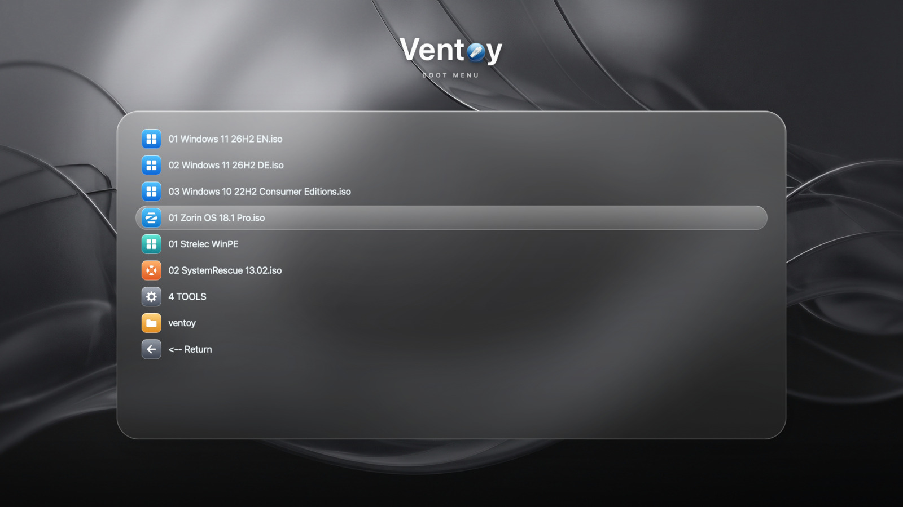
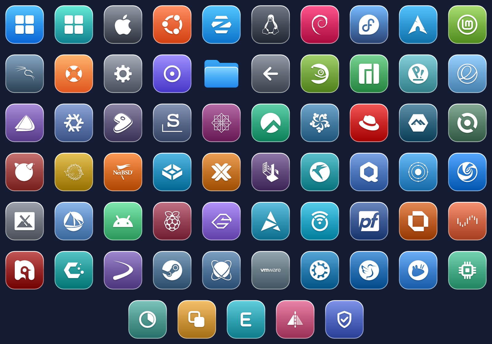

# Ventoy-Liquid

A dark, frosted "liquid glass" theme for the [Ventoy](https://www.ventoy.net) boot menu, inspired by recent macOS.



_The preview is a mock-up rendered on a Mac; real GRUB rendering may differ slightly._



## Features

- 1920x1080 neutral graphite glass wallpaper with a frosted menu panel
- Crisp 52px glass-tile icons for Windows, WinPE, macOS, about 50 Linux/BSD distributions and appliances, rescue/disk tools (EaseUS, Macrium, Acronis, Clonezilla, GParted, Memtest), plus a blue macOS-style folder and Ventoy's own back/disc entries (see the preview and class list below)
- Rounded pill selection, styled GRUB terminal box, timeout countdown and mode labels
- Inter font (`.pf2`) for crisp menu text

## Install

1. Copy the `Ventoy-Liquid` folder to `ventoy/themes/` on your Ventoy USB drive.
2. Add this to `ventoy/ventoy.json` (create the file if it does not exist):

```json
{
    "theme": {
        "file": "/ventoy/themes/Ventoy-Liquid/theme.txt",
        "gfxmode": "max",
        "ventoy_left": "3%",
        "ventoy_top": "95%",
        "ventoy_color": "#cfe0e6",
        "fonts": [
            "/ventoy/themes/Ventoy-Liquid/fonts/Inter-Regular-22.pf2",
            "/ventoy/themes/Ventoy-Liquid/fonts/Inter-Medium-22.pf2",
            "/ventoy/themes/Ventoy-Liquid/fonts/Inter-Regular-16.pf2"
        ]
    },
    "menu_class": [
        { "key": "EaseUS", "class": "easeus" },
        { "key": "WinPE", "class": "winpe" },
        { "key": "ubuntu", "class": "ubuntu" },
        { "key": "Ubuntu", "class": "ubuntu" }
    ]
}
```

[`ventoy.example.json`](ventoy.example.json) has the complete `menu_class` list (about 240 rules) for every icon, including the full `theme` block. Copy it or merge its `menu_class` into your own file.

How the rules work (see Ventoy's [Menu Class plugin](https://www.ventoy.net/en/plugin_menuclass.html)):

- `key` is a **case-sensitive** substring of the ISO file name (the path is not checked), so `Ubuntu` does not match `ubuntu-24.04.iso`. The example file therefore lists each key in its original, lower-case and capitalised form.
- The **first** matching rule wins, so specific keys (`EaseUS`, `Kubuntu`) come before generic ones (`WinPE`, `Ubuntu`, `Linux`).
- The class is the icon file name: `easeus` shows `icons/easeus.png`. Entries without a match fall back to the built-in classes (`vtoyiso`, `vtoydir` for the blue folder, `vtoyret`, ...).
- Every rule slows down loading the menu a little. Delete the ones for systems you do not have.
- To theme a whole folder instead, use `{ "dir": "/1 ISOS/LINUX", "class": "linux" }` (folder entry) or `{ "parent": "/1 ISOS/LINUX", "class": "linux" }` (all images in it). Paths have no trailing slash.

The `fonts` list is required, Ventoy only loads fonts that are registered there.

## Rebuild the assets

- `generate_background.swift` (macOS): composites `source/wallpaper.jpg`, the glass panel and the title into `background.png`.
- `generate_icons.cjs` (Node): renders the icons, selection pill and terminal box. Needs `npm i simple-icons @resvg/resvg-js`.
- `generate_ventoy_json.cjs` (Node): writes `ventoy.example.json` from a list of (class, keys) pairs; keep it in sync when adding an icon.
- The `.pf2` fonts were made with `grub-mkfont` from the Inter static TTFs.

## Credits and licences

- Theme code and original artwork: MIT, see [LICENSE](LICENSE). The wallpaper was generated with AI.
- [Inter](https://rsms.me/inter/) font: SIL Open Font License 1.1, see `Ventoy-Liquid/fonts/Inter-LICENSE.txt`.
- Brand glyph paths: [Simple Icons](https://simpleicons.org) (CC0). The Windows glyph is hand-drawn.
- The Ventoy logo in the title is from the [Ventoy](https://github.com/ventoy/Ventoy) project (GPL-3.0).
- Operating system and company logos are trademarks of their respective owners and are used only to identify the matching boot entries. This project is not affiliated with or endorsed by any of them.
